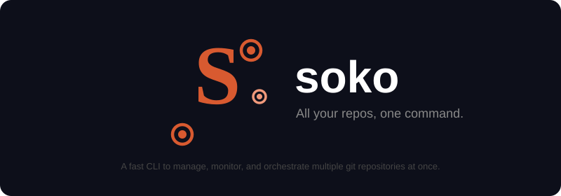

<p align="center">
  
</p>

<p align="center">
  <strong>All your repos, one command.</strong>
</p>

soko is a lightweight CLI for managing multiple Git repositories. Register your
repos once, then check their status from anywhere—without hopping between
directories.

```text
  REPO               BRANCH       STATUS       ↑↓         LAST COMMIT
  ──────────────────────────────────────────────────────────────────────────────
  auth-service       feat/sso     ✎ 3M         ↑2         2h ago  feat: add OAuth
  backend-api        main         ✓ clean      ↓3         1d ago  fix: rate limiter
  frontend           dev          ✎ 1M 2U      ↑1         4h ago  refactor: nav bar

  3 repos · 2 dirty · 1 behind · 6 changes
```

## Install

**Homebrew (macOS / Linux):**

```bash
brew install CelikE/tap/soko
```

**Quick installer (macOS / Linux):**

```bash
curl -fsSL https://raw.githubusercontent.com/CelikE/soko/master/install.sh | sh
```

Git must be installed. macOS requires version 13 Ventura or newer. No Go
toolchain is needed unless you build from source.

For Windows (winget / Scoop), Go installation, or prebuilt binaries, see
[all installation options](docs/guide.md#install).

## Quick start

```bash
# Discover and register repos under your projects directory
soko scan ~/projects

# See their status from anywhere
soko status
```

Scanning registers repositories; it does not change their Git contents. To
register just one repo, run `soko init` inside it instead.

That's it. No shell integration or config editing required.

## Everyday commands

```bash
soko status --dirty        # Find repos with uncommitted changes
soko status --fetch        # Fetch first for fresh ahead/behind counts
soko diff                  # Review uncommitted changes across repos
soko sync                  # Fetch all repos, fast-forward the safe ones
soko ui                    # Open the live terminal dashboard
soko grep TODO             # Search tracked files across repos
soko exec -- make test     # Run a command in every registered repo
```

`sync` only pulls clean repos with an upstream and no divergence. Repos needing
attention are reported without pulling; it never merges or rebases.

Group repos with tags when you want to narrow your workspace:

```bash
soko scan ~/work --tag work
soko status --tag work
soko sync --tag work
```

Use `soko --help` to explore commands, or `soko <command> --help` for its options.

## Optional: jump between repos

Shell integration is only needed for directory navigation and automatic
discovery—not for status or other ordinary commands.

For Bash or Zsh, add this to `~/.bashrc` or `~/.zshrc`, then reload your shell:

```bash
eval "$(soko shell-init)"
```

Then jump by name or choose interactively:

```bash
soko cd auth               # Jump to a repo by name or prefix
soko go                    # Pick a repo interactively
```

[Fish and PowerShell setup →](docs/guide.md#navigation)

## More workflows

soko also supports Git worktrees, workspace contexts, snapshots, and scripting.
Pick the guide you need rather than learning everything upfront.

| I want to… | Read |
|---|---|
| Explore every command and flag | [Command reference](docs/guide.md#commands) |
| Manage Git worktrees | [Worktrees](docs/guide.md#git-worktrees) |
| Save and resume work across repos | [Workspace contexts](docs/guide.md#workspace-contexts) |
| Record exact branches and commits | [Snapshots](docs/guide.md#snapshots) |
| Clean up merged branches | [Branch cleanup and safety notes](docs/guide.md#clean-up-stale-branches) |
| Register repos automatically | [Automatic discovery](docs/guide.md#automatic-discovery) |
| Use JSON output in scripts or CI | [JSON support, errors, and exit codes](docs/guide.md#json-output) |
| Change settings or inspect the registry | [Configuration](docs/guide.md#configuration) |

The [full user guide](docs/guide.md) keeps detailed examples and safety notes
together. For an offline reference, use `man soko`; see
[manual installation](docs/guide.md#manual) if it is unavailable.

## Development

soko is a single Go binary that uses the Git CLI directly. Want to contribute?
See [building and local checks](docs/guide.md#building-from-source),
[CLI compatibility contracts](docs/cli-contracts.md), and the
[changelog](CHANGELOG.md).

## License

[MIT](LICENSE)
